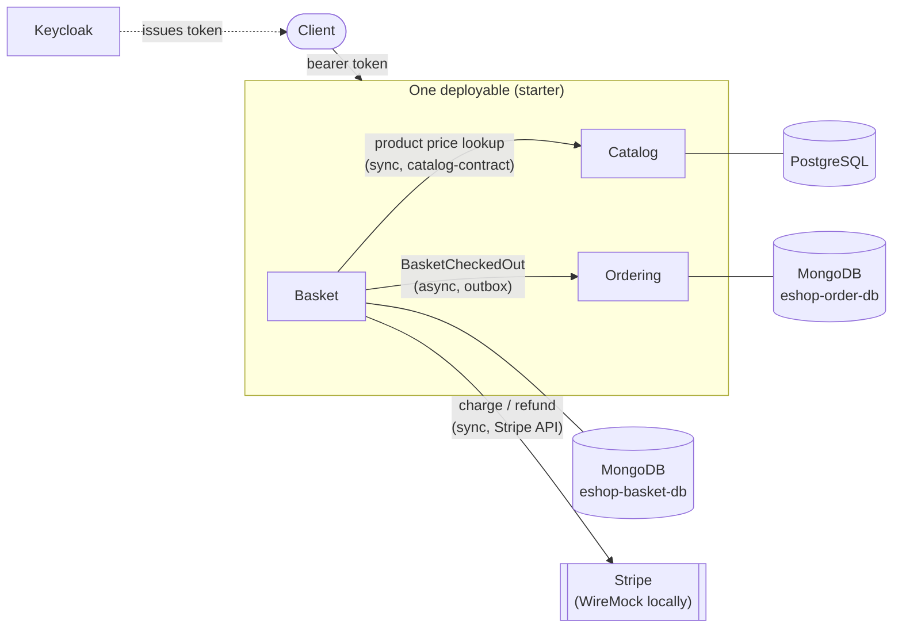

[](https://sonarcloud.io/summary/new_code?id=TomMante_SpringBoot-EshopModularMonolith)
[](https://sonarcloud.io/summary/new_code?id=TomMante_SpringBoot-EshopModularMonolith)

# EShop Modular Monolith

An e-shop backend in Spring Boot 4 and Java 25, built as a modular monolith whose modules are kept
as separable as microservices: each owns its own database, cross-module writes go through a
transactional outbox on two storage engines, and the module boundaries are checked by an ArchUnit
test on every build.

**Run it locally** (JDK 25 and Docker):

```bash
docker compose -f SpringBoot-EshopModularMonolith/docker/sb-eshop/compose.yaml up -d
cd SpringBoot-EshopModularMonolith && ./mvnw install -DskipTests
./mvnw -pl starter spring-boot:run
```

**Or without a JDK** (Docker only): compose builds the image from source and runs it with the stack.

```bash
docker compose -f SpringBoot-EshopModularMonolith/docker/sb-eshop/compose.yaml --profile app up -d --build --wait
```

Every endpoint needs a token. [SETUP.md](docs/SETUP.md) walks from here to a placed order, and
the [Bruno collection](bruno/README.md) covers every endpoint.

## How it fits together



- **Separate databases.** No module reads another's tables or collections, and there are no
  cross-module transactions. State changes cross modules as events; reads of another module's
  current data go through its contract. [Cross-module communication](docs/ARCHITECTURE.md#-cross-module-communication)
  and [trade-offs](docs/ARCHITECTURE.md#architectural-trade-offs).
- **Outbox on two engines.** Basket writes `BasketCheckedOut` to its outbox in the same Mongo
  transaction as the checkout; a dispatcher publishes it and Ordering creates the order. Catalog
  runs the same mechanism on JPA.
- **Enforced boundaries.** An ArchUnit test fails the build if a module reaches past another's
  `contract` package, or if domain code depends on Spring or infrastructure — see *Enforced by
  `ArchitectureTest`* in [Architecture](docs/ARCHITECTURE.md).
- **CQRS read side.** Queries skip the aggregates and return contract DTOs straight from the store.
- **Secured.** Endpoints are an OAuth2 resource server against Keycloak; the compose stack imports
  the realm and two demo users.

- **No card data in the system.** Checkout receives a payment method token from Stripe, never a
  card number or CVV, and charges it through a `PaymentGateway` port before the basket transaction
  opens; if that transaction then fails, the charge is refunded. Orders keep only the charge
  reference, the amount and a card summary. Locally a WireMock container plays Stripe, answering
  with Stripe's documented successes and declines. See
  [Payment provider](docs/ARCHITECTURE.md#-payment-provider), and
  [what PCI DSS allows](ai-coding-tools/context/card-data-and-pci-dss.md).

**Scope choice: payments.** The integration is Stripe's
[card payments without bank authentication](https://docs.stripe.com/payments/without-card-authentication)
flow: synchronous, server-side, and documented by Stripe for US and Canadian cards only. Cards
that need 3-D Secure are declined. A European production shop would confirm in the browser with
Stripe's Payment Element and handle 3-D Secure and webhooks instead. The Stripe pages the code was
checked against are listed in [stripe-integration.md](ai-coding-tools/context/stripe-integration.md).

## Background

This project serves as a study/blueprint for a Spring Boot modular monolith. It also deliberately pushes microservice-readiness to an extreme, both to explore its complexity and to play around with some ideas.

The core idea stems from Packt's *.NET 8 Backend Bootcamp: Modulith, VSA, DDD, CQRS and Outbox*
([course on O'Reilly](https://learning.oreilly.com/course/net-8-backend/9781837028757/),
[original .NET source code](https://github.com/PacktPublishing/.NET-8-Backend-Bootcamp---Modulith-VSA-DDD-CQRS-and-Outbox)),
which shows how to implement a modular monolith using DDD, CQRS and VSA.

The outbox, the module-boundary checks and the module-scoped wiring are built by hand here. In
the Spring ecosystem, [Spring Modulith](https://spring.io/projects/spring-modulith) provides much
of that out of the box. [A comparison](docs/SPRING_MODULITH.md) maps what it would replace in
this codebase, and why its single event registry doesn't fit per-module databases.

**How it is built.** I write the application code and its tests. A coding agent investigates,
proposes designs, writes the plans, reviews what I wrote and keeps the docs current. When I hand
it a piece of implementation, I do so explicitly and for that piece only. The working agreement
is in [rules of engagement](ai-coding-tools/processes/rules-of-engagement.md), and every plan is
in [`ai-coding-tools/plans/`](ai-coding-tools/plans/).

## Changes from original .NET course

I took that base and ported it over to the Spring Boot/Java world and added my own ideas. The main concepts I added are:
1. **Transactional outbox on two engines.** One `OutboxEventStore` port in `outbox-core` with a JPA adapter (`outbox-jpa`, used by Catalog) and a MongoDB adapter (`outbox-mongo`, used by Basket), both driven by the same dispatch logic, including retry with exponential backoff, a dead-letter state for events that keep failing, and schema-versioned payloads that are upcast on read and checked against captured fixtures. A module gets the outbox by depending on one adapter.
2. **Per-module database isolation, on purpose.** Each module owns its database instead of sharing a schema, to push microservice-readiness as far as it goes. What that costs (no cross-module transactions, dual writes, eventual consistency) and what I'd choose in production is set out in [Architecture](docs/ARCHITECTURE.md#architectural-trade-offs).
3. Used TDD, borrowing the given-when-then convention from BDD. Where tests sit and how they are named is set out in [Testing Conventions](docs/TESTING_CONVENTIONS.md).
4. Split the domain from the infrastructure using ports, so the domain does not depend on the persistence technology. This is put to use: Basket and Ordering run on MongoDB while Catalog stays on JPA/PostgreSQL, behind the same kind of ports.
5. Used separate repositories for write and read. Commands go through the aggregate and its repository; queries go through their own query port and return contract DTOs straight from the store, bypassing the domain. Coming from an event-sourcing project, I see the value of a separate read database; both sides share one store today, and how a dedicated read model could grow from this split is explored in [Design Notes](docs/DESIGN_NOTES.md).
6. Leveraged Spring Auditables to add auditing to objects.
7. **Card payments through a provider token.** Checkout charges a Stripe payment method through a port and a `stripe-java` adapter, outside the basket transaction, with idempotency keys and a refund when the transaction fails. The adapter is tested against Stripe-shaped WireMock stubs that the compose stack also serves.

## 📖 Documentation Index

Detailed documentation is located in the `docs/` directory:
- **[Architecture (DDD, CQRS, Modules)](docs/ARCHITECTURE.md)**
- **[Spring Modulith (what it would replace here, and what it wouldn't) — to review](docs/SPRING_MODULITH.md)**
- **[Design Notes (options and open questions, not decisions)](docs/DESIGN_NOTES.md)**
- **[Known Issues (defects & testing gaps)](docs/KNOWN_ISSUES.md)**
- **[Backlog (work deliberately postponed)](docs/BACKLOG.md)**
- **[Testing Conventions (what to test, where, and what to call it)](docs/TESTING_CONVENTIONS.md)**
- **[Coverage Aggregation (how the coverage number is produced)](docs/COVERAGE.md)**
- **[Setup Instructions](docs/SETUP.md)**

## Repository Structure

| Path | Contents |
| --- | --- |
| `SpringBoot-EshopModularMonolith/` | The application: Maven multi-module build, a multi-stage Dockerfile that builds from source into a layered image running as a non-root user, and the local compose stack in `docker/sb-eshop/`, which can also run the application. It sits one level down so the root can hold the material below alongside it. |
| `docs/` | Architecture, testing conventions, known issues, backlog, design notes, setup, and a comparison with Spring Modulith. |
| `bruno/` | A [Bruno](https://www.usebruno.com/) collection covering every endpoint, including the token request. |
| `Kubernetes/` | Illustrative manifests for running the application on a local Minikube. They cover the application only; PostgreSQL, MongoDB and Keycloak are not included. |
| `.github/workflows/` | CI and PR builds; `main` is also analysed on SonarCloud. |
| `ai-coding-tools/` | How this project is built with a coding agent: process docs, one plan per increment recording what was decided and why, background research those decisions rest on, and scripts that run the suite and summarize coverage. |

## License

[MIT](LICENSE). The original .NET course code this project is based on is also
MIT-licensed, © 2024 Packt; this repository is an independent Java/Spring Boot
rewrite of its design, not a copy of its code.
