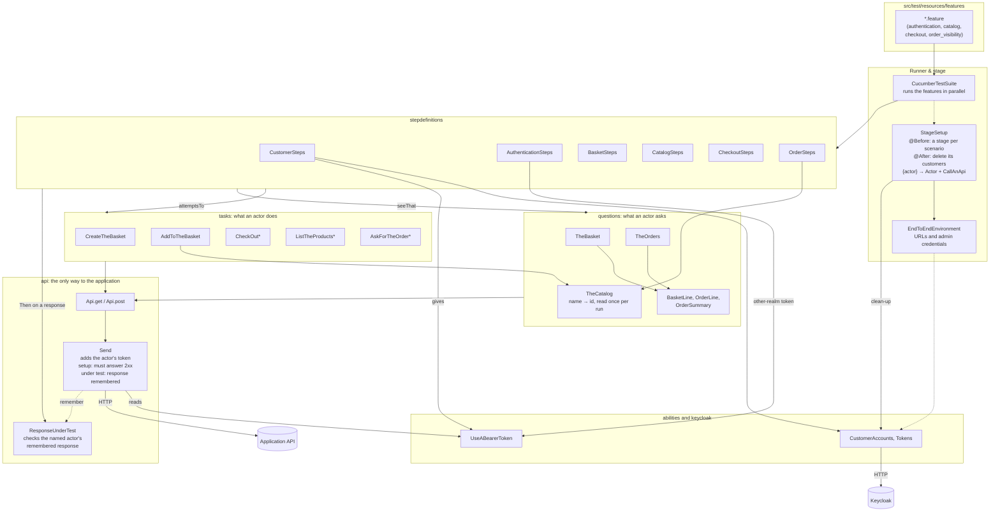

# End-to-end tests

Serenity BDD scenarios (Cucumber, Screenplay) that drive the running system from the outside:
the application's HTTP API, real Keycloak tokens, and the `payment-provider` container standing
in for Stripe. A separate Maven project, not part of the application's build; it knows only two
base URLs.

| Feature | What it checks |
| --- | --- |
| `catalog.feature` | The seeded products are listed |
| `authentication.feature` | No token, or a token from another realm, is refused; a customer's token is accepted |
| `checkout.feature` | A paid checkout becomes exactly one order with the right line, total and card; a declined one keeps the basket and creates no order |
| `order_visibility.feature` | A customer finds their own order by id; another customer gets `404` and an empty list |

## Running it

**In Docker** (no JDK needed), from the repository root:

```bash
docker compose -f backend/docker/sb-eshop/compose.yaml --profile e2e run --rm --build e2e
```

Compose builds and starts the application and its stack, waits until the application and
Keycloak report ready, then runs `./mvnw -B verify` in a stock JDK 25 container with this folder
mounted. The command exits with the suite's exit code. The first run downloads Maven and the
suite's dependencies into the `e2e-maven-repository` volume; later runs reuse it. The stack keeps
running afterwards: stop it with `down` and `--profile e2e`, and note that `-v` also drops the
Maven volume (see [Starting over](../docs/SETUP.md#starting-over)).

The container runs as root, so on a Linux host with native Docker Engine, `target/` is left
owned by root and a later `./mvnw clean` on the host fails. Remove it once with
`sudo rm -rf e2e/target`. Docker Desktop (on any OS) and rootless Docker map ownership to your
user, so they aren't affected.

**From the host** (JDK 25), with the application already running, either under `--profile app`
or on the host (see [SETUP.md](../docs/SETUP.md)):

```bash
cd e2e && ./mvnw verify
```

**In CI**, the [end-to-end workflow](../.github/workflows/spring_boot_eshopmodularmonolith_e2e.yml)
runs the same compose command after every merge to `main` that touches the application, this
folder or the workflow, and can be started by hand from the Actions tab. It doesn't run on pull
requests. The report is uploaded as the `serenity-report` artifact, and a failed run prints the
stack's logs.

## Settings

| Variable | Default | In the `e2e` container |
| --- | --- | --- |
| `E2E_APP_URL` | `http://localhost:8080` | `http://app:8080` |
| `E2E_KEYCLOAK_URL` | `http://localhost:9090` | `http://keycloak:8080` |
| `E2E_KEYCLOAK_ADMIN_USER` | `admin` | default |
| `E2E_KEYCLOAK_ADMIN_PASSWORD` | `admin` | default |

The admin credentials are the Keycloak container's own, committed in `compose.yaml`. The suite
uses them to create a fresh customer for each actor in each scenario. An `@After` hook deletes
those customers, best-effort: a failed deletion is logged, not failed, since a leftover `e2e-*`
user harms nothing and `down -v` drops them all. Orders placed by deleted customers stay in
MongoDB; nothing reads them.

## Parallelism

Scenarios run on 4 threads (`src/test/resources/junit-platform.properties`). The count is fixed
rather than tied to CPU cores, since scenarios wait on HTTP and the outbox, not on the CPU.
Override it for one run:

```bash
./mvnw verify -Dcucumber.execution.parallel.config.fixed.parallelism=1
```

**Rule for new scenarios: shared data is read-only.** Today that's the seeded catalog. A
scenario that writes catalog data creates its own product and reads only that one; otherwise one
scenario's price change breaks another's total.

## Code layout

Arrows point from the caller to what it uses. `*` marks a task with a setup variant and an
`.asTheRequestUnderTest()` variant.



- **Identity:** "is a customer" creates a Keycloak user through the admin API and gives the actor
  its token as the `UseABearerToken` ability. An actor without one, like Visitor, sends requests
  without a token. `StageSetup` deletes the scenario's users afterwards.
- **Requests:** every task and question sends through `Send` (see *Writing a scenario* below).
- **Checks:** *Then* steps use questions for state, and `ResponseUnderTest` for the answer to the
  *When*'s request.

## Writing a scenario

- **Send every request through `Api`** (`Api.get`, `Api.post` in `api/`), never Serenity's `Get`
  or `Post` directly. `Api` adds the actor's token whenever the actor has one, so a request goes
  out without a token only because the actor holds none, like Visitor.
- **Only a *When* sends the request under test,** with `.asTheRequestUnderTest()`. Its response
  is remembered by the actor who sent it, and response steps check it with
  `seeThatTheResponseUnderTest`. A question asked in between, or another actor's request, doesn't
  change which response a step checks.
- **Every other request must succeed.** Setup tasks and questions fail on their own step with
  the status and body when they get anything other than 2xx, rather than on a later step.
- **Look products up by name only among the seeded ones.** `TheCatalog` reads the seeded
  catalog once per run. A product a scenario creates is known by the id its create request
  returned.

## The report

`target/site/serenity/index.html`, written by both ways of running the suite. In CI, download
the `serenity-report` artifact from the run.
